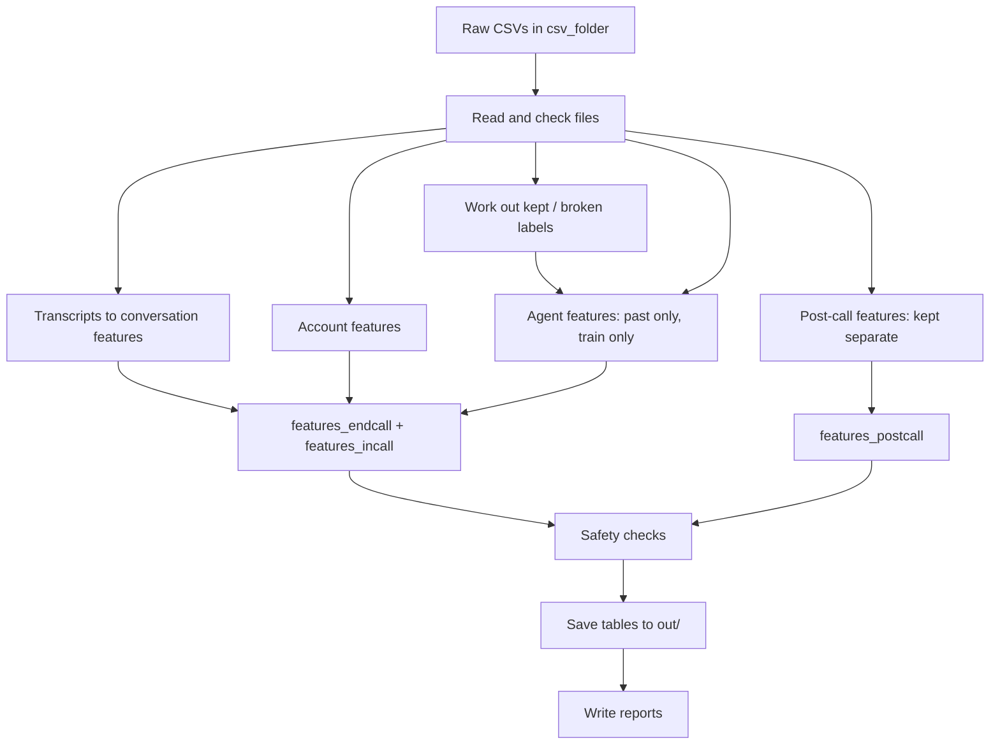

# File Guide: What Every File Does

This guide explains, in plain words, what each file in this folder is for and how data
flows through the pipeline from raw CSVs to finished feature tables.

For the reasoning behind the design (why things are built this way), see
[PHASE2_EXPLAINED.md](PHASE2_EXPLAINED.md).

---

## The short version

The pipeline reads raw data about loan-repayment promises, works out facts about each
promise ("did the borrower hesitate?", "is payday after the promised date?"), and writes
those facts into tables that a model can learn from. It also writes reports that check the
work.

```
csv_folder/  ──►  ptp_features/ (the engine)  ──►  out/ (tables + reports)
   raw data          run by run.py                    results
```

---

## The workflow, step by step

When you run `python run.py`, this happens in order:

### Step 1: Read the raw data
`pipeline.py` reads every CSV in `csv_folder/`. If a required file or column is missing,
it stops and tells you what is missing. `annotated_ptp_sample.csv` is optional.

### Step 2: Work out which promises were kept
To build some agent features, the pipeline needs to know which past promises were kept. If
Phase 1 has supplied a label file (`phase1_labels.csv`), that is used. Otherwise the
pipeline works it out itself: a promise counts as kept if the borrower paid at least 80% of
the promised amount, through a channel the borrower chose, by the end of the third day
after the promised date.

### Step 3: Turn each call into features
For every promise that came from a phone call, the pipeline:

1. Finds the call's transcript and puts the turns in order.
2. Cleans each turn's text (lowercase, removes punctuation, reads `₹` as rupees).
3. Looks for phrases (hedging, hardship, "I have to go"…), dates and money amounts.
4. Builds the feature rows:
   - **One row per borrower turn** (the in-call table), using only the turns up to that
     point, so a live model never sees the future.
   - **One row for the whole call** (the end-call table), which is the same calculation
     at the last turn.

Promises from field visits have no call, so they get a row with `has_transcript = 0` and
blank conversation features.

### Step 4: Add account facts
For each promise, the pipeline joins in what was known about the account at the time:
amount overdue, salary day, past promises, and so on. It also calculates things like
"does the promise fall just before payday?"

### Step 5: Add agent facts
For each promise, the pipeline looks up the agent's track record, using only:
- promises whose outcome was **already known** before this call, and
- accounts in the **training** split.

This stops the model from learning from the future or from test data.

### Step 6: Add post-call facts (kept separate)
Things that happen after the call (link opened, WhatsApp reply, borrower calls back) go
into their **own table**, counted only up to the promised date. They never enter the other
two tables. The pipeline checks this and crashes if they do.

### Step 7: Safety checks and save
The pipeline checks that no post-call column, outcome label or human annotation ended up in
a feature table. Then it writes every table to `out/` as CSV (and Parquet).

### Step 8: Write the reports
`audit.py` writes four reports: data coverage, leakage checks, a dictionary of every
feature, and a comparison against the human annotations.



---

## Files in the main folder

| File | What it does |
| --- | --- |
| `run.py` | **The file you run.** Starts the whole pipeline: reads data, builds the tables, writes the reports. `python run.py` uses `csv_folder/` and writes to `out/`. |
| `tests.py` | 32 automatic checks that the pipeline is correct (no future data leaking in, amounts read correctly, and so on). Run `python tests.py`. |
| `verify_real_samples.py` | Runs the feature code on two real calls and checks 19 expected results, such as "the borrower mentioned hardship" or "the bot proposed the amount first". |
| `make_synthetic.py` | Creates fake data in the same format as the real data, for testing without real files. Its numbers mean nothing. |
| `requirements.txt` | The Python libraries needed: pandas, numpy, pyarrow. Install with `pip install -r requirements.txt`. |
| `PHASE2_EXPLAINED.md` | The full explanation of the design, decisions, bugs found and next steps. |
| `FILE_GUIDE.md` | This file. |
| `coverage_report.md` | Copy of the coverage report (see the `out/` section). |
| `leakage_audit.md` | Copy of the leakage report. |
| `feature_dictionary.csv` / `.md` | Copy of the feature dictionary. |
| `annotation_check.md` | Copy of the annotation comparison report. |

---

## The engine: `ptp_features/`

These files do the real work. You don't run them directly; `run.py` uses them.

| File | What it does |
| --- | --- |
| `__init__.py` | Marks the folder as a Python package. Nothing to change here. |
| `config.py` | **Every setting in one place:** where the data lives, which payment channels count as the borrower paying, how many grace days are allowed, the minimum history needed before an agent statistic is trusted, and so on. Change numbers here, not inside the other files. |
| `lexicons.py` | The phrase lists in English, Hindi and Kannada, grouped by meaning (hedging, hardship, refusal, "I have to go"…). Also cleans text and counts how many phrases from each group appear. |
| `extractors.py` | Finds **money amounts** ("Rs 4,200", "5 hazaar") and **dates** ("3 April", "kal", "next week") in a sentence. It can tell "7 days" from "Rs 7", and an exact date from a vague one. Also spots when the bot asks "by which date?" or pushes for a minimum payment. |
| `features.py` | **The heart of the pipeline.** Given a call and a turn number, it computes about 125 conversation features using only the turns up to that point: who mentioned the amount first, how long the borrower paused before promising, whether they hedged, and so on. |
| `context.py` | Builds **account features** (overdue amount, salary timing, promise size versus ability to pay) and **agent features** (the agent's past keep rate, how often they log promises, late-evening bunching, copy-pasted remarks), always using only past data. |
| `pipeline.py` | **The conductor.** Loads the CSVs, works out labels, calls the other files in order, joins everything into the three tables, runs the safety checks and saves the output. |
| `audit.py` | Writes the reports: coverage, leakage checks, the feature dictionary, and the annotation comparison. |

---

## Input data: `csv_folder/`

| File | What it contains |
| --- | --- |
| `ptps.csv` | **One row per promise to pay**: who promised, how much, by when, and whether it came from a call or a field visit. Everything is built around this file. |
| `call_transcripts.csv` | What was said on each call, turn by turn, with timings and speech-recognition confidence. |
| `accounts.csv` | One row per loan account: overdue amount, EMI, salary day, past promises, credit score band, and so on. |
| `agents.csv` | One row per agent or bot: channel, language team, experience. |
| `dial_attempts.csv` | Every call attempt, including unanswered ones, with the agent's remark. Used for agent statistics. |
| `payments.csv` | Every payment received, with channel. Used to work out whether promises were kept. |
| `post_call_events.csv` | Things that happened after the call: link sent or opened, WhatsApp confirmations, callbacks. |
| `splits.csv` | Which accounts are in the train, validation or test set. Decided per account, so one account never appears in two sets. |
| `lenders.csv` | The lenders and their type (bank, NBFC…). |
| `annotated_ptp_sample.csv` | *(Optional)* 200 promises that people labelled by type (genuine, escape, third party…). Used **only** to check the features, never as a feature. |

---

## Output: `out/`

Created when you run `run.py`. Safe to delete; it is rebuilt each run.

| File | What it contains | Who uses it |
| --- | --- | --- |
| `features_endcall.csv` / `.parquet` | **One row per promise** with everything known when the call ended. | Team C's main training table |
| `features_incall.csv` / `.parquet` | **One row per borrower turn**, with only what was known at that moment. | The live, mid-call model |
| `features_postcall.csv` / `.parquet` | Post-call signals (link opened, reply sent…), counted up to the promised date only. | Only the follow-up / parking-window model |
| `labels.csv` / `.parquet` | Whether each promise was kept, and where that label came from (`label_source`). | Agent features and the reports; **never** a model input |
| `coverage_report.md` / `.json` | How much data was covered: promises with transcripts, phrase-list coverage per language, splits, and the emptiest features. | Anyone checking data quality |
| `leakage_audit.md` | Checks that nothing from the future or the test set leaked into the features. | Team C, reviewers |
| `feature_dictionary.csv` / `.md` | Every column: what it means, when it is available, how often it is blank, and any caveat. | Team C |
| `annotation_check.md` / `.json` | How the features compare with the human labels (train and validation promises only). | Whoever improves the phrase lists and rules |

---

## Common tasks

| I want to… | Do this |
| --- | --- |
| Build everything | `python run.py` |
| Use data from another folder | `python run.py --data-dir path/to/csvs --out-dir path/to/output` |
| Check nothing is broken | `python tests.py` and `python verify_real_samples.py` |
| Change a setting (grace days, channels…) | Edit `ptp_features/config.py`, then re-run |
| Add a new phrase | Add it to the right list in `ptp_features/lexicons.py`, then re-run |
| Use Phase 1's official labels | Put `phase1_labels.csv` (columns `ptp_id`, `kept`) in `csv_folder/`, then re-run |
| Find out what a column means | Look it up in `feature_dictionary.md` |
